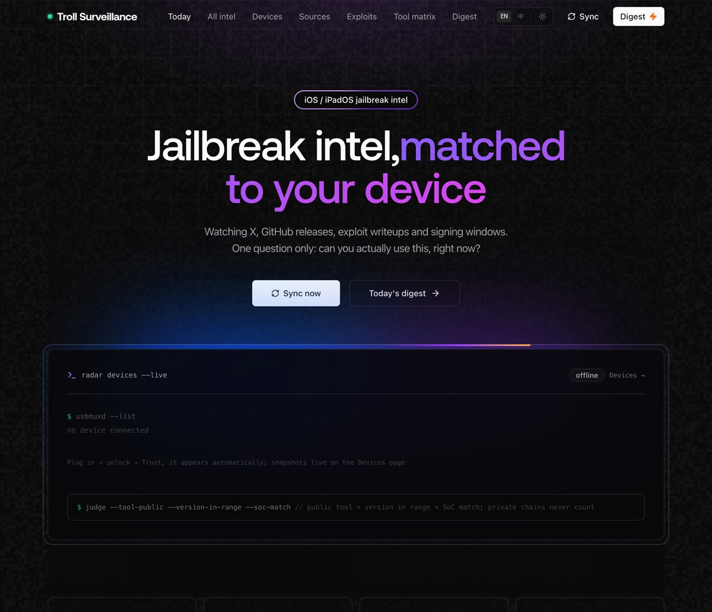
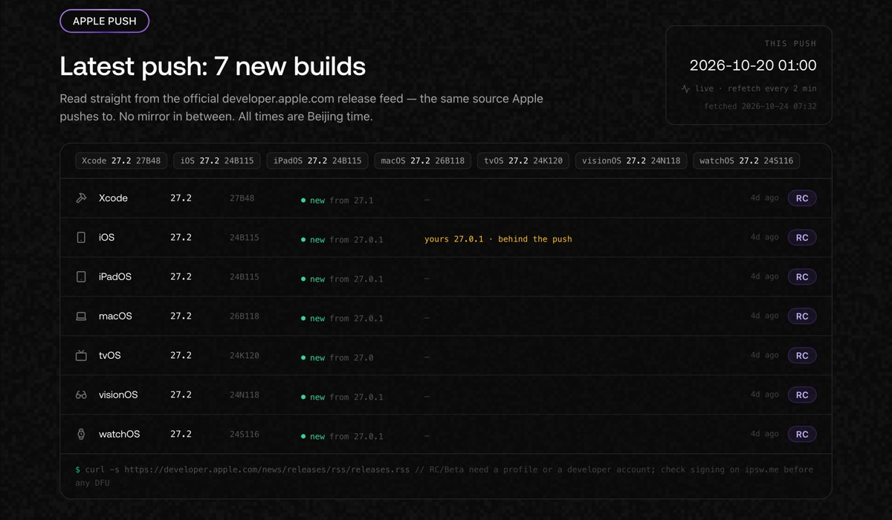
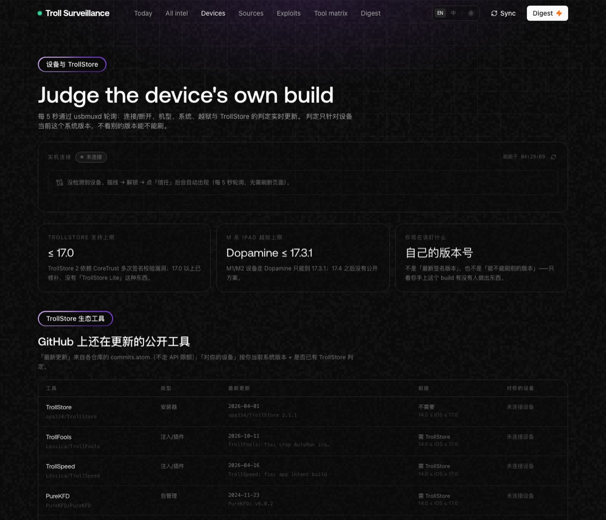
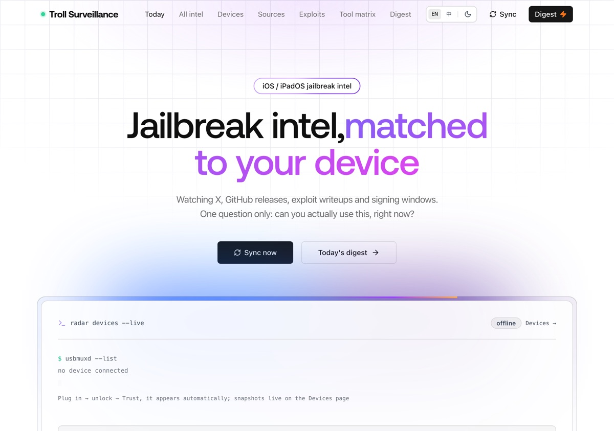
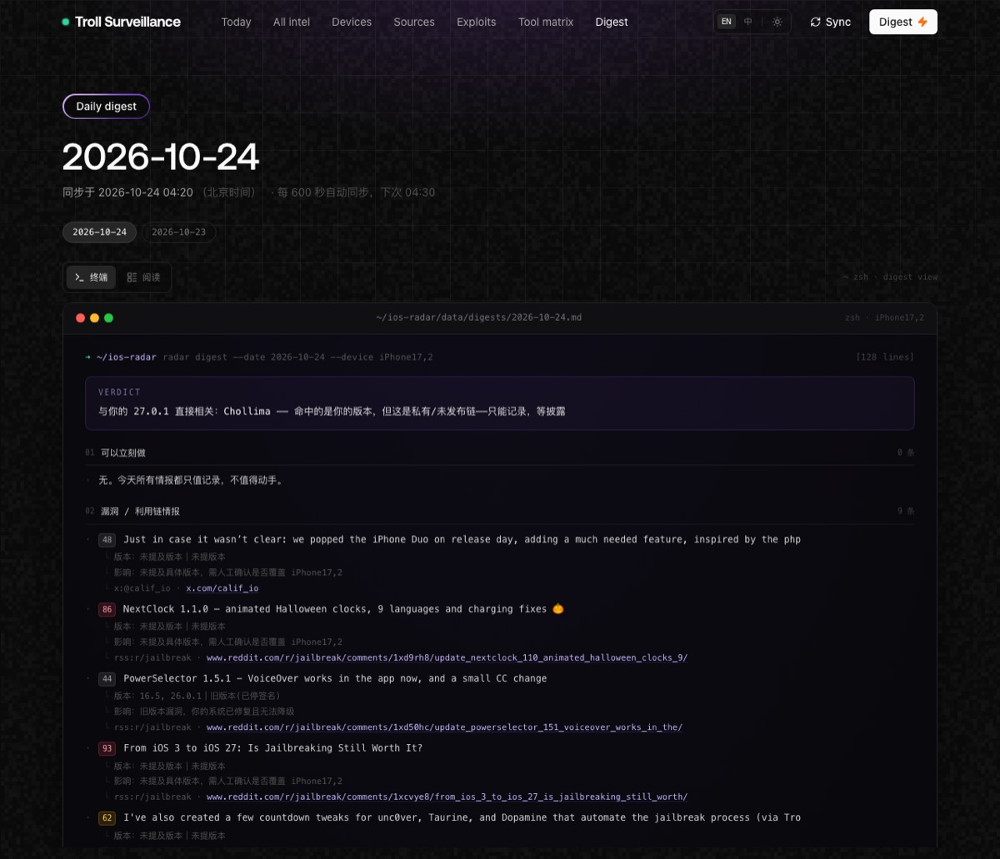
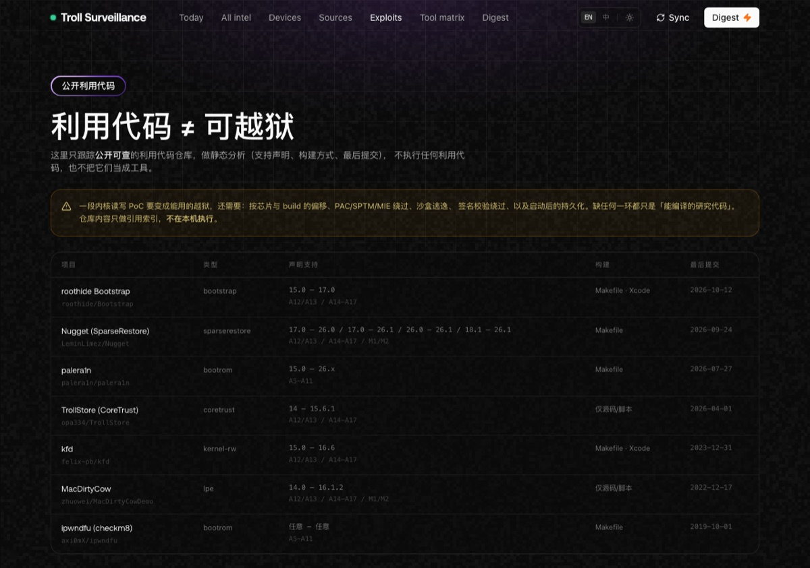

# Troll Surveillance

**English** · [简体中文](README.zh-CN.md)

> A self-hosted intelligence desk for the iOS jailbreak / TrollStore ecosystem.
> It answers one question: **is this thing actually usable on *my* device, right now?**



---

## Why

Jailbreak news is noisy and almost always untethered from reality. A tool "supports iOS 17" means nothing until you check three things at once: is it **public**, does your **build** fall inside its range, and does it cover your **SoC**. Troll Surveillance automates that judgement, watches the people who actually ship things, and keeps a daily digest that never lags behind.

## Features

### Monitoring
- **X / Twitter** — 13 researchers and teams (opa334, Calif.io, roothide, 82Flex, Lessica, LCFR, dhinakg, …) via `r.jina.ai`, **no API key required**
- **GitHub** — releases + commits through the API, plus `commits.atom` for the TrollStore-ecosystem repos so the 60 req/h quota is never the bottleneck
- **RSS** — iDownloadBlog, iClarified, r/jailbreak, r/Trollstore, Apple Developer News
- **The Apple Wiki** — wikitext diff for change detection + `TextExtracts` for clean prose (no infobox garbage)
- **ipsw.me** — live signing window per device identifier
- **Apple security releases** and **Relaxin** (parsed straight out of the SPA bundle — the project has no public repo)

### Apple platform push
- Reads `developer.apple.com/news/releases/rss/releases.rss` directly — the feed Apple itself publishes, no mirror in between
- Items that share one pubDate are grouped into **one push**, so the page says "Apple shipped 7 builds" instead of showing seven unrelated rows
- Every platform (Xcode, iOS, iPadOS, macOS, tvOS, visionOS, watchOS) gets version, build and channel (RC / Beta / release), plus a **new vs unchanged** marker; new rows also say what they upgraded from
- Each row is compared against your connected device or the saved profile — `yours 27.0.1 · behind the push`
- Refetched every 2 minutes, and on every 600s sync, so an official release lands on its own
- `/api/os` exposes the same rows, the push history and the new/old flags



### Judgement engine
- Keyword scoring (untether, 0day, MIE/PAC/SPTM, kernel, CoreTrust, …) with weights and evidence trails
- **Version extraction + SoC matching** — every item is classified `direct` / `future` / `obsolete` against your device
- **Actionable** only when *public tool ✚ version in range ✚ SoC supported* — private chains never count
- Per-SoC ceilings (Dopamine: A12/A13 → 26.0.1, A14–A17/M1/M2 → 17.3.1) and **non-contiguous ranges** (Relaxin: 16.5–18.7.1 **or** 26.0–26.0.1)
- Tool-version dedupe, 5-year recency cutoff, scam detection, stale-snapshot tagging

### Devices
- **Live enumeration over usbmuxd**, polled every 5s — plug in, it appears; unplug, it disappears
- iPhone **and** iPad side by side, each with its own verdicts
- **"How far am I from usable"** math: `TrollStore needs ≤ 17.0 — you are 0.4.1 above`
- **Restore warning** when the running build is no longer signed (a DFU would force-update the device)
- Works with the device disconnected: the terminal frame stays, only the device rows hide



### Interface

- **Bilingual** — EN / 中 switch in the navbar, persisted in a cookie, deep-linkable via `?lang=en`; resolved on the server so there is no flash
- **Light + dark theme** — ☀ / ☾ toggle, `?theme=light` deep link, semantic tokens plus remapped neutrals
- **Redact mode** — `?redact=1` masks UDID tail, model number and region so screenshots are safe to publish



### Digest
- Daily markdown archive (`data/digests/YYYY-MM-DD.md`) **rewritten on every sync**
- Two renderings of the same document: a **macOS terminal view** (default) and a reading view
- Sections: verdict → actionable → exploits → tool releases → **latest 24h (pure time order)** → authors → signing → scams → tool matrix → source health
- All timestamps in **Asia/Shanghai**, item ordering strictly newest-first



### Research assets
- `docs/x-sources.md` — 27 accounts / 102 posts with date, video flag and **direct `status/<id>` links**
- `docs/chollima-video-analysis.md` — frame-by-frame OCR teardown of Calif's Hexonite demo (what the SSH session actually is, what the chain must contain)

## Quick start

```bash
git clone https://github.com/<you>/Troll-Surveillance.git
cd Troll-Surveillance

npm install
cp .env.example .env        # optional: GITHUB_TOKEN to raise the API limit
npm run build
./start.sh                  # Next server + 600s watcher
```

Open <http://127.0.0.1:3210>. You can also reach it from a phone on the same LAN via the printed LAN URL.

```bash
npm run dev                 # dev mode
npm run sync                # one-shot sync
npm run watch               # foreground watcher (600s)
WATCH_MS=300000 ./start.sh  # 5-minute cadence
```

Requirements: macOS or Linux, Node 20+, `libimobiledevice` (`brew install libimobiledevice`) for device detection.

## How the verdict works

Three gates, all must pass:

| Gate | Meaning |
| --- | --- |
| Public | A downloadable tool exists. Private chains and "coming soon" do not count. |
| Version | Your **build** sits inside the tool's declared range. Updating past it loses the tool forever (Apple stops signing). |
| SoC | A11 and older rely on the `checkm8` bootROM bug; A12+ needs software exploits plus PAC/SPTM/MIE bypasses. They do not cross generations. |

The tool registry lives in `lib/knowledge.ts`; device-side TrollStore tooling lives in `lib/trollstore.ts`.

## Data sources

| Source | Implementation | Notes |
| --- | --- | --- |
| X | `lib/collect/x.ts` + `lib/xfilter.ts` | markdown via r.jina.ai, cleaned and relevance-gated (drops off-topic posts and login-page boilerplate) |
| GitHub | `lib/collect/github.ts`, `lib/collect/ghatom.ts` | API for releases/commits, atom feeds for ecosystem repos |
| RSS | `lib/collect/rss.ts` | 429/403 triggers a 30-minute cooldown |
| The Apple Wiki | `lib/collect/wiki.ts` | diff for change detection, extracts for display |
| Firmware signing | `lib/collect/ipsw.ts` | per-identifier signed list |
| Apple security | `lib/collect/apple.ts` | advisory titles |
| Relaxin | `lib/collect/relaxin.ts` | version + support matrix parsed from the site bundle |
| Apple platform releases | `lib/osversions.ts`, `lib/collect/apple.ts` | official developer releases RSS; same-timestamp items collapse into one push |

## API

| Method | Route | Description |
| --- | --- | --- |
| POST/GET | `/api/sync[?force=1]` | run a sync; `force` ignores X cooldowns |
| GET | `/api/items?cat=&actionable=1&limit=` | raw items |
| GET | `/api/devices` | live usbmuxd enumeration with per-device verdicts |
| GET | `/api/digest?date=` | markdown digest |
| GET | `/api/watch` | watcher state (interval, last/next run, errors) |
| GET | `/api/health` | sync health and signing snapshot |
| GET | `/api/os[?force=1]` | platform versions, push history, new/old flags |
| GET/POST | `/api/profile` | read/update the judgement target |

## Project layout

```
app/            pages + API routes
components/     UI (Linkify skin, live devices, digest renderer)
lib/            analyze, digest, sync, devices, trollstore, osversions, fresh, dedupe, xfilter
lib/collect/    source adapters
scripts/        sync, watch, reanalyze, device, dossier, purge-x
data/           runtime state (git-ignored): items, meta, digests, device snapshots
docs/           research docs and screenshots
```

## Limitations

- X has no free API; scraping through r.jina.ai can be rate-limited, loses exact timestamps and video frames
- GitHub unauthenticated is 60 req/h — set `GITHUB_TOKEN`
- Apple's security page and Relaxin's SPA are scraped; a redesign breaks those adapters (they show up red in the health table)
- The engine is keyword + version matching: it will not miss a fact, but a low score is not proof of irrelevance

## Disclaimer

Troll Surveillance is an **information project**. It does not ship exploits, patched IPSWs, or jailbreak tooling. Device verdicts are advisory and derived from public statements by the tools' own authors. Freezing a device on an old iOS build means forgoing security fixes — that trade-off is yours. Use at your own risk; not affiliated with Apple, Calif.io, or any tool vendor.

## Exploit tracking (/exploits)

- **Registry** — `lib/exploits.ts`: ipwndfu/checkm8, kfd, MacDirtyCow, TrollStore CoreTrust, palera1n, Nugget SparseRestore, roothide Bootstrap
- **Probe** — `scripts/exploit-probe.ts` reads each repo's `commits.atom` (last commit) and `README` (declared iOS ranges, build system) into `data/exploits.json`
- **Surfacing** — `/exploits` lists declared support, build system and last commit; `/devices` shows which public exploits cover each connected device
- **Static only** — nothing is executed. A public PoC is not a usable jailbreak: you still need a sandbox escape, PAC/SPTM/MIE bypass, code-signing bypass and boot persistence



## Star History

<a href="https://www.star-history.com/?repos=icecokei%2Ftroll-surveillance.git&type=timeline&legend=bottom-right">
 <picture>
   <source media="(prefers-color-scheme: dark)" srcset="https://api.star-history.com/chart?repos=icecokei/troll-surveillance.git&type=timeline&theme=dark&legend=bottom-right" />
   <source media="(prefers-color-scheme: light)" srcset="https://api.star-history.com/chart?repos=icecokei/troll-surveillance.git&type=timeline&legend=bottom-right" />
   
 </picture>
</a>

## License

MIT — see [LICENSE](LICENSE).
