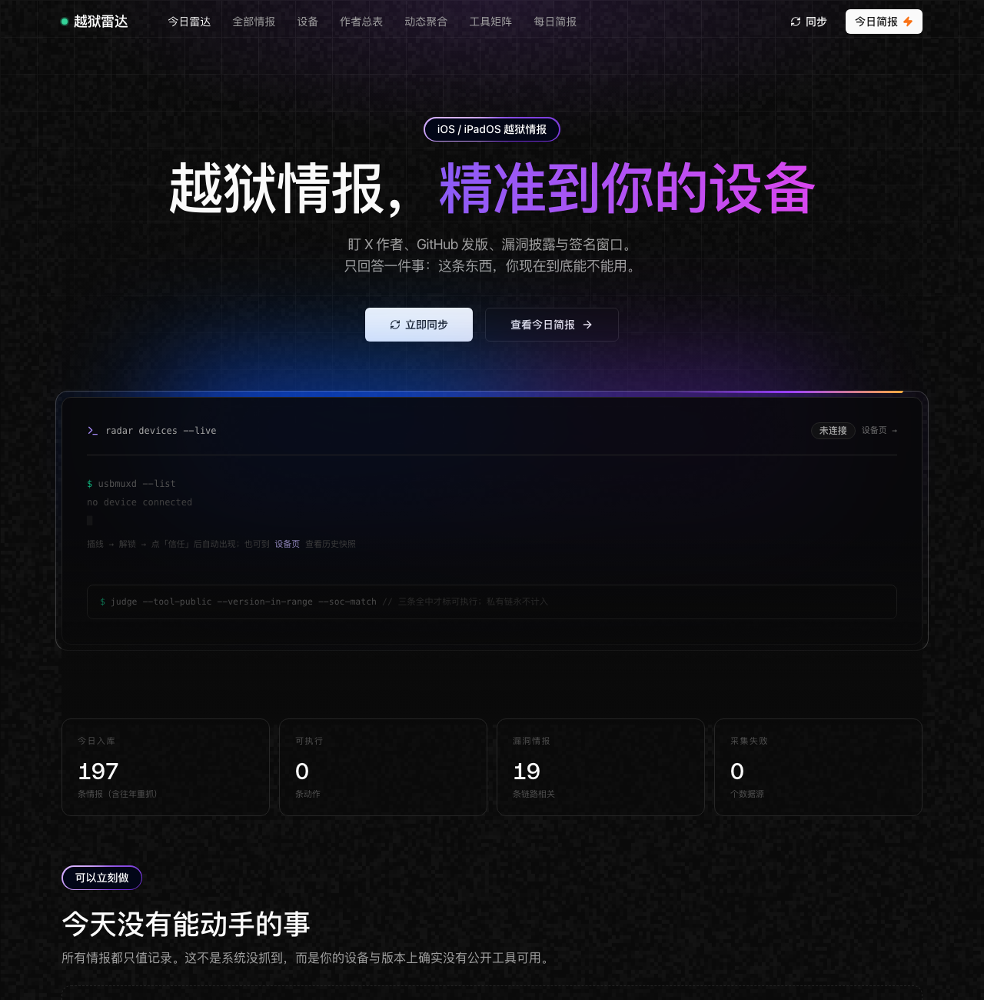
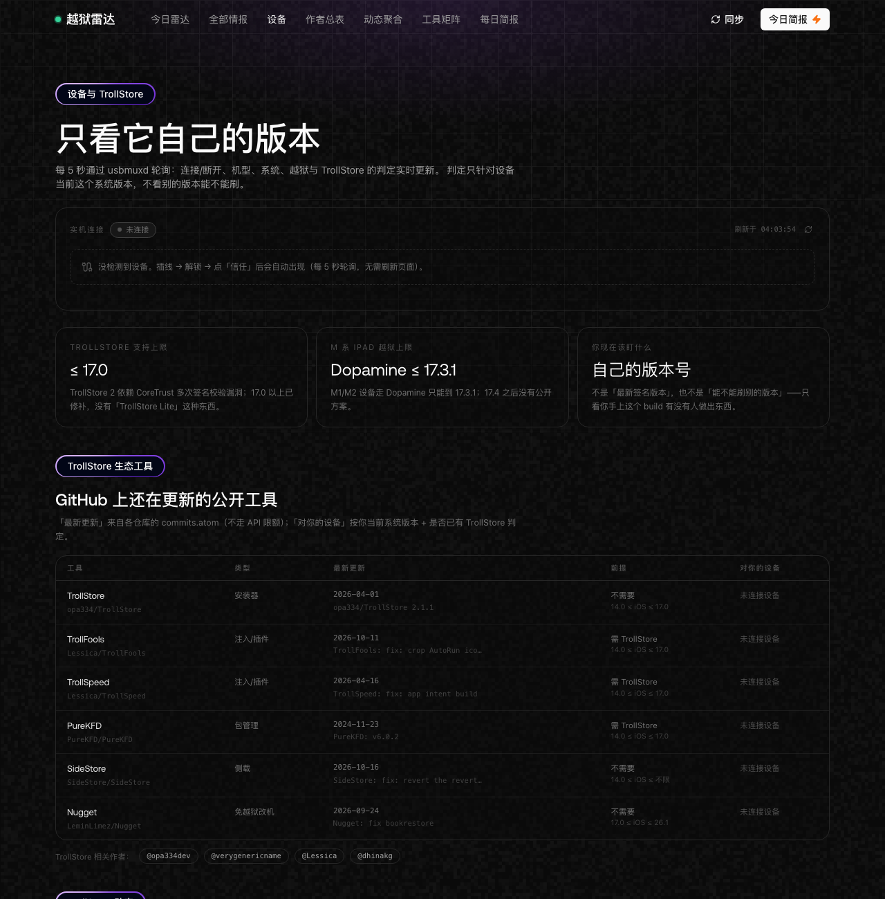
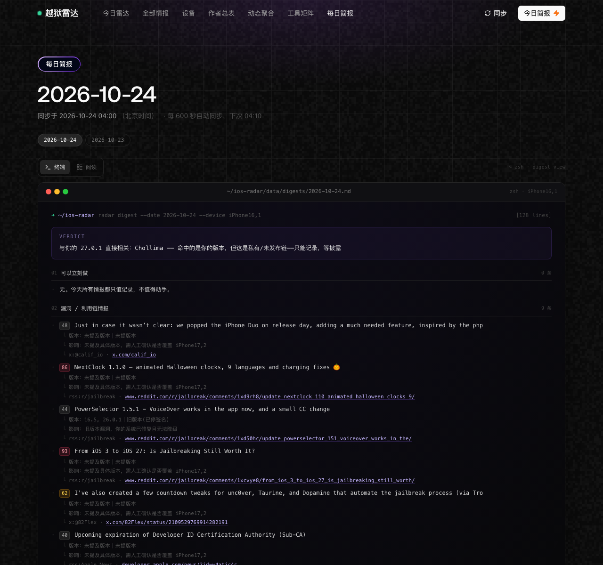

# Troll Surveillance（iOS 越狱雷达）

[English](README.md) · **简体中文**

> 自托管的 iOS 越狱 / TrollStore 情报台。
> 只回答一个问题：**这东西，现在到底能不能用在*我*的设备上？**



---

## 为什么做这个

越狱圈的信息噪音极大，而且几乎都和现实脱节。「支持 iOS 17」这句话没有意义，除非同时确认三件事：工具**已公开**、你的 **build** 落在支持区间、你的 **SoC** 在覆盖范围。Troll Surveillance 把这套判断自动化，盯住真正发东西的人，并维护一份不会滞后的每日简报。

## 功能

### 监控
- **X / Twitter** —— 13 个研究者与团队（opa334、Calif.io、roothide、82Flex、Lessica、LCFR、dhinakg 等），走 `r.jina.ai`，**不需要 API key**
- **GitHub** —— releases + commits 走 API；TrollStore 生态仓库改走 `commits.atom`，不受 60 次/小时限额影响
- **RSS** —— iDownloadBlog、iClarified、r/jailbreak、r/Trollstore、Apple Developer News
- **The Apple Wiki** —— wikitext 做变更检测，`TextExtracts` 取干净正文（不再混入 infobox）
- **ipsw.me** —— 按机型标识实时查询签名窗口
- **Apple 安全公告** 与 **Relaxin**（直接解析它的 SPA bundle —— 该项目没有公开仓库）

### 判定引擎
- 关键词加权（untether、0day、MIE/PAC/SPTM、内核、CoreTrust…）并保留证据链
- **版本抽取 + SoC 匹配**：每条情报相对你的设备判定为 `direct` / `future` / `obsolete`
- 只有「**工具公开 ✚ 版本在区间 ✚ SoC 支持**」三条全中才标「可执行」，私有链永不计入
- 支持**按 SoC 分档**（Dopamine：A12/A13 → 26.0.1，A14–A17/M1/M2 → 17.3.1）与**非连续区间**（Relaxin：16.5–18.7.1 **或** 26.0–26.0.1）
- 同工具版本去重、5 年时效截断、骗局识别、状态型快照标记

### 设备
- **通过 usbmuxd 实时枚举**，5 秒轮询：插上出现，拔掉消失
- iPhone 与 iPad 并列，各自独立判定
- **「离可用还差多少」**：`TrollStore 需要 ≤ 17.0 —— 你比上限高 0.4.1`
- 当前版本已停签名时给出**还原警告**（一 DFU 就会被强制升级）
- 未连接时终端窗口保留，只隐藏设备行



### 简报
- 每日 markdown 归档（`data/digests/YYYY-MM-DD.md`），**每轮同步都重写**
- 同一份文档两种渲染：**macOS 终端视图**（默认）与阅读视图
- 结构：一句话结论 → 可执行 → 漏洞 → 工具发版 → **近 24 小时最新动态（纯时间序）** → 作者动态 → 版本签名 → 骗局 → 工具矩阵 → 采集健康度
- 全部时间以东八区显示，条目严格新在上



### 研究资料
- `docs/x-sources.md` —— 27 个账号 / 102 条贴文，含日期、是否含视频、**可直接打开的 `status/<id>` 直链**
- `docs/chollima-video-analysis.md` —— Calif 演示视频的逐帧 OCR 拆解（SSH 会话到底是什么、链条必然包含哪几段）

## 快速开始

```bash
git clone https://github.com/<you>/Troll-Surveillance.git
cd Troll-Surveillance

npm install
cp .env.example .env        # 可选：填 GITHUB_TOKEN 提高 API 限额
npm run build
./start.sh                  # 启动 Next 服务 + 600 秒抓取器
```

打开 <http://127.0.0.1:3210>；终端会同时打印局域网地址，手机可直接访问。

```bash
npm run dev                 # 开发模式
npm run sync                # 手动同步一次
npm run watch               # 前台运行抓取器（600 秒）
WATCH_MS=300000 ./start.sh  # 改成 5 分钟
```

环境要求：macOS 或 Linux、Node 20+；设备检测需要 `libimobiledevice`（`brew install libimobiledevice`）。

## 判定逻辑

三道门，必须全过：

| 门 | 含义 |
| --- | --- |
| 公开 | 存在可下载的工具。私有链、「即将发布」都不算。 |
| 版本 | 你的 **build** 落在工具声明区间内。越过去就永远失去这个工具（Apple 会停签名）。 |
| SoC | A11 及更早依赖 `checkm8` bootROM 漏洞；A12+ 需要软件漏洞 + PAC/SPTM/MIE 绕过，跨代不通用。 |

工具矩阵在 `lib/knowledge.ts`；设备侧的 TrollStore 生态工具在 `lib/trollstore.ts`。

## 数据源

| 源 | 实现 | 说明 |
| --- | --- | --- |
| X | `lib/collect/x.ts` + `lib/xfilter.ts` | 经 r.jina.ai 取 markdown，清洗 + 相关性过滤（丢弃离题贴文与登录页模板） |
| GitHub | `lib/collect/github.ts`、`lib/collect/ghatom.ts` | API 抓 releases/commits，生态仓库走 atom |
| RSS | `lib/collect/rss.ts` | 命中 429/403 时进入 30 分钟冷却 |
| The Apple Wiki | `lib/collect/wiki.ts` | wikitext 检测变更，extracts 用于展示 |
| 固件签名 | `lib/collect/ipsw.ts` | 按机型标识取签名列表 |
| Apple 安全公告 | `lib/collect/apple.ts` | 公告标题 |
| Relaxin | `lib/collect/relaxin.ts` | 从站点 bundle 解析版本与支持矩阵 |

## API

| 方法 | 路径 | 说明 |
| --- | --- | --- |
| POST/GET | `/api/sync[?force=1]` | 触发同步；`force` 忽略 X 冷却 |
| GET | `/api/items?cat=&actionable=1&limit=` | 原始条目 |
| GET | `/api/devices` | 实时枚举设备并给出逐设备判定 |
| GET | `/api/digest?date=` | markdown 简报 |
| GET | `/api/watch` | 抓取器状态（间隔、上次/下次、错误） |
| GET | `/api/health` | 同步健康度与签名快照 |
| GET/POST | `/api/profile` | 读取/修改判定目标 |

## 目录结构

```
app/            页面与 API
components/     UI（Linkify 皮肤、实时设备、简报渲染）
lib/            analyze / digest / sync / devices / trollstore / fresh / dedupe / xfilter
lib/collect/    各数据源适配器
scripts/        sync、watch、reanalyze、device、dossier、purge-x
data/           运行时状态（已 gitignore）：items、meta、digests、设备快照
docs/           研究文档与截图
```

## 已知限制

- X 没有免费 API，经 r.jina.ai 抓取可能被限流，且拿不到精确时间戳与视频画面
- GitHub 未认证仅 60 次/小时，建议配置 `GITHUB_TOKEN`
- Apple 安全页与 Relaxin 的 SPA 都是抓取实现，改版会失效（健康度表里会变红）
- 引擎是关键词 + 版本匹配：不漏事实，但低分不等于无关

## 免责声明

Troll Surveillance 是**信息项目**，不分发漏洞利用、修改版固件或越狱工具。设备判定仅供参考，依据是各工具作者自己的公开声明。把设备冻结在旧系统意味着放弃安全更新，这个取舍由你承担。使用风险自负；与 Apple、Calif.io 或任何工具厂商无关。

## Star History

<a href="https://www.star-history.com/?repos=icecokei%2Ftroll-surveillance.git&type=timeline&legend=bottom-right">
 <picture>
   <source media="(prefers-color-scheme: dark)" srcset="https://api.star-history.com/chart?repos=icecokei/troll-surveillance.git&type=timeline&theme=dark&legend=bottom-right" />
   <source media="(prefers-color-scheme: light)" srcset="https://api.star-history.com/chart?repos=icecokei/troll-surveillance.git&type=timeline&legend=bottom-right" />
   
 </picture>
</a>

## 许可证

MIT —— 见 [LICENSE](LICENSE)。
